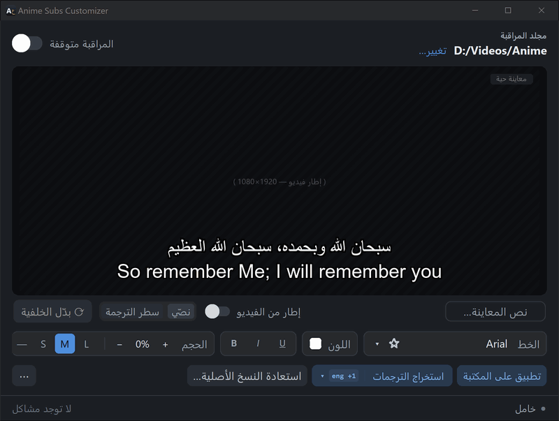

العربية · [**English**](README.md)

# Anime Subs Customizer

**اجعل كل ترجمة أنمي سهلة القراءة: بخطك ولونك المفضّلين، مع حدٍّ أسود واضح، وتلقائيًا.**

### [⬇ تنزيل للويندوز](https://github.com/roko-tech/Anime-Subs-Customizer/releases/latest/download/AnimeSubsCustomizer-Setup.exe)

ويندوز 10 أو 11 · مجاني ومفتوح المصدر · لا يحتاج صلاحيات المسؤول · بالعربية والإنجليزية

تصل إصدارات الترجمة بالتنسيق الذي اختاره صانعها: خط صغير، أو ألوان باهتة، أو خطوط لا تعرض العربية. يراقب Anime Subs Customizer مجلد الأنمي لديك ويعيد تنسيق **الحوار** في ملفات الترجمة ‎`.ass`‎ بالخط واللون اللذين تختارهما، سواء في الملفات الموجودة أصلًا أو في الملفات الجديدة بعد ثوانٍ من وصولها. تحتفظ اللافتات والأغاني والكاريوكي بمظهرها الأصلي، و**يُحفظ كل ملف أصلي**، فيمكنك دائمًا التراجع.

## ابدأ في ثلاث خطوات

1. **ثبّت التطبيق.** نزّل المثبّت من الرابط أعلاه وافتحه. قد يحذّرك ويندوز بأن التطبيق «لا يُنزَّل عادةً» أو بأنه «حمى جهازك»، لأن التطبيق جديد وغير موقَّع رقميًا بعد. [هذا ما تضغطه، وهكذا تتحقق من الملف أولًا.](docs/install-help.ar.md)
2. **اختر مجلد الأنمي وخطًّا ولونًا.** تعرض المعاينة الحية شكل ترجماتك بالضبط.
3. **شغّل المراقبة.** يخبرك التطبيق بعدد ملفات الترجمة التي سيعيد تنسيقها ويسألك مرة واحدة، ثم يُبقي مكتبتك كلها منسّقة، حتى الحلقات الجديدة.

## ماذا يحدث لملفاتي؟

- **لا يتغيّر إلا ملفات الترجمة ‎`.ass`‎**، وأنماط الحوار فيها فقط: الخط واللون والعريض/المائل/التسطير، وحدّ وظل أسودان بحجم يناسب الفيديو، والحجم إن اخترته. لا تتغيّر ملفات الفيديو ولا ملفات ‎`.srt`‎ أبدًا.
- **تبقى اللافتات والأغاني والكاريوكي والكتابة على الشاشة كما هي**، فتظل مطابقة للفيديو. (في ملفات الترجمة القديمة التي تخلو من إعداد ‎`ScaledBorderAndShadow`‎ قد ترسم بعض المشغّلات حدود اللافتات أعرض قليلًا.)
- **يُحفظ كل ملف أصلي.** قبل أول تنسيق لأي ملف ترجمة، ينسخه التطبيق إلى مجلد «Original Subs» بجانبه. ويعيد زر **استعادة النسخ الأصلية…** الملفات الأصلية لمسلسل واحد أو لها جميعًا.
- **تُحفظ الإصدارات الجديدة أيضًا.** إذا استبدل برنامج تنزيل (مثل Bazarr أو Sonarr أو تنزيل يدوي) ملف ترجمة بإصدار أحدث، يصبح هذا الإصدار هو النسخة الأصلية المحفوظة، وتنتقل النسخة الأقدم إلى ‎`Original Subs\.older`‎.
- **لا يُكتب أي ملف نصفه.** تُحفظ الملفات في خطوة واحدة آمنة. إذا حدث خطأ، يبقى الملف القديم كما هو، ويظهر السبب في «المشاكل» أسفل النافذة.
- **تبقى الملفات المستعادة على حالها الأصلية.** بعد **استعادة النسخ الأصلية…** لا تغيّر المراقبة تلك الملفات حتى تصل نسخة جديدة منها، ويعيد **تطبيق على المكتبة** تنسيقها إن غيّرت رأيك.

## تحذيرات ويندوز و«التحكم الذكي في التطبيقات» وبرامج الحماية

التطبيق غير موقَّع رقميًا بعد، لذلك لا يتعرّف عليه ويندوز. عادةً يظهر لك تحذير واحد عند التثبيت، ولا شيء بعده.

- في متصفح Edge: **«… لا يُنزَّل عادةً»**. افتح قائمة `⋯` بجانب الملف المنزَّل، واختر **الاحتفاظ**، ثم **إظهار المزيد**، ثم **الاحتفاظ على أي حال**.
- **«حمى Windows جهاز الكمبيوتر الخاص بك»**: اضغط **مزيد من المعلومات** ثم **تشغيل على أي حال**.
- **التحكم الذكي في التطبيقات** (في بعض أجهزة ويندوز 11) قد يمنع التطبيقات غير الموقَّعة دون زر «تشغيل على أي حال».

يشرح [دليل التثبيت](docs/install-help.ar.md) كل حالة بالصور، وكيف تتأكد من أن الملف الذي نزّلته أصلي، وما خياراتك مع «التحكم الذكي في التطبيقات».

## أسئلة شائعة

<b>المشغّل لا يعرض الخط الجديد</b>

يجب أن يكون الخط مثبّتًا على الجهاز أو التلفاز الذي يشغّل الفيديو، فاختر خطًّا مثبّتًا هناك أيضًا. بعض المشغّلات وأجهزة التلفاز تتجاهل تنسيق ‎`.ass`‎، أو تعرض الترجمة المضمَّنة في الفيديو بدل ملف ‎`.ass`‎ المجاور له: اختر مسار الترجمة الخارجي من المشغّل. المشغّلات mpv وMPC-HC وPotPlayer وVLC تعرض تنسيق ‎`.ass`‎.

<b>يبدو النص أكبر أو أصغر مع خط آخر</b>

تهدف الأحجام **S / M / L** إلى حجم ظاهر واحد مع كل الخطوط، لكن المشغّلات تقيس الخط بتباعد أسطره، فقد يظهر الخط الذي تباعد أسطره كبير أو صغير على غير المعتاد أكبر أو أصغر بوضوح. اضبط حجم ذلك الخط بالزرّين **− / +**، ويتذكّر التطبيق الضبط لكل خط.

<b>كيف أتراجع عن كل شيء؟</b>

أوقف **المراقبة**، ثم اضغط **استعادة النسخ الأصلية…** واختر مسلسلًا أو المسلسلات كلها. يُستبدل كل ملف ترجمة بنسخته الأصلية المحفوظة.

<b>بعض الترجمات لم تتغيّر</b>

يترك التطبيق الملف كما هو إذا كان الخط لا يدعم لغته (مثل ترجمة إنجليزية مع خط عربي فقط)، أو إذا لم يكن فيه حوار، أو إذا غيّره برنامج آخر بعد تنسيقه. وتعرض لوحة «المشاكل» أسفل النافذة كل ما لم ينجح وسببه.

<b>هل يستطيع استخراج الترجمات من ملفات الفيديو؟</b>

نعم. فعّل **استخراج الترجمات**، واختر اللغات من زر `▾` بجانبه، فيحفظ التطبيق الترجمات المضمَّنة في الفيديوهات الجديدة بجانبها (FFmpeg مرفق مع التطبيق). ويعمل **⋯ ← استخراج كل الترجمات** على المكتبة كلها.

<b>أين تُحفظ إعداداتي؟</b>

في ‎`%LOCALAPPDATA%\Anime Subs Customizer`‎ (الصق هذا في شريط العنوان في مستكشف الملفات). أما النسخة المحمولة فتحفظها في مجلدها.

<b>جهازان يشتركان في مكتبة واحدة</b>

اجعل جهازًا واحدًا فقط يراقب المجلد. إذا راقبه نسختان بإعدادات مختلفة، تعيد كل نسخة تنسيق الملف مرة واحدة على الأكثر ثم تترك عمل الأخرى كما هو، فتبقى بعض الحلقات بتنسيق النسخة الأخرى.

المزيد في **[دليل الاستخدام](docs/guide.ar.md)**.

## الخصوصية

لا حساب ولا جمع للبيانات. لا يتصل التطبيق بالإنترنت إلا إذا فعّلت **التحقق من التحديثات مرة يوميًا**، وعندها يسأل GitHub مرة في اليوم عن رقم أحدث إصدار، فيرى GitHub عنوان IP الخاص بك وإصدار التطبيق فقط. تبقى السجلات على جهازك، وفيها أسماء مجلداتك وملفاتك، فراجعها قبل إرفاقها ببلاغ عن مشكلة.

## إلغاء التثبيت

**الإعدادات ← التطبيقات ← التطبيقات المثبّتة ← Anime Subs Customizer ← إلغاء التثبيت.** ستُسأل إن كنت تريد حذف إعداداتك أيضًا. تبقى ترجماتك منسّقة: لاسترجاع النسخ الأصلية استخدم **استعادة النسخ الأصلية…** قبل إلغاء التثبيت، أو احتفظ بمجلدات «Original Subs».

## المتطلبات

ويندوز 10 (الإصدار 1809 أو أحدث) أو ويندوز 11 بنظام 64 بت، ونحو 70 ميغابايت من المساحة مع FFmpeg.

## الشكر والترخيص

Anime Subs Customizer مرخّص برخصة [MIT](LICENSE). ويتضمّن [FFmpeg](https://ffmpeg.org) برخصة LGPL لاستخراج الترجمات ولقطات المعاينة، ومكوّنات أخرى مذكورة في ملف ‎`THIRD-PARTY-NOTICES.txt`‎ المثبّت مع التطبيق والمرفق بكل إصدار.

وجدت مشكلة أو لديك فكرة؟ [افتح بلاغًا](https://github.com/roko-tech/Anime-Subs-Customizer/issues/new/choose). للمشكلات الأمنية راجع [SECURITY.md](SECURITY.md). للمطوّرين: [docs/development.md](docs/development.md) و[CONTRIBUTING.md](CONTRIBUTING.md).

