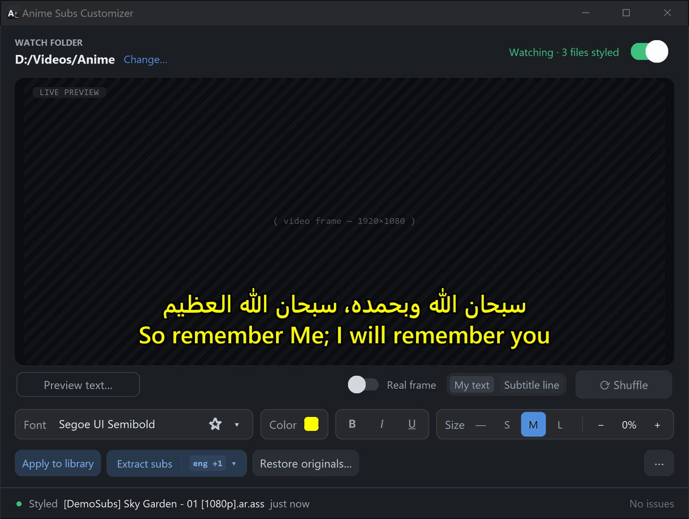
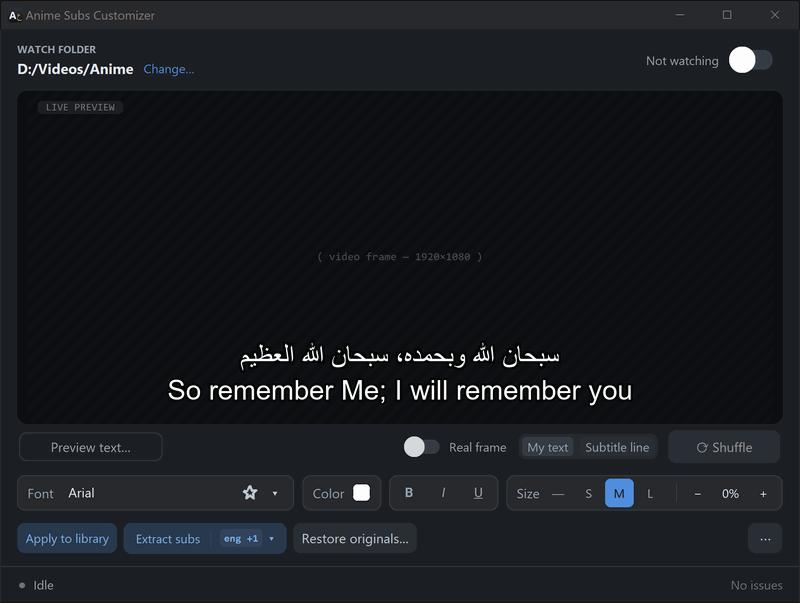

[**العربية**](README.ar.md) · English

# Anime Subs Customizer

**Make every anime subtitle easy to read: your font, your colour, a clean black outline, automatically.**

### [⬇ Download for Windows](https://github.com/roko-tech/Anime-Subs-Customizer/releases/latest/download/AnimeSubsCustomizer-Setup.exe)

Windows 10 or 11 · free and open source · no administrator rights needed · English and Arabic

Fansub releases come with whatever style the encoder picked: tiny fonts, washed-out colours, fonts that can't show Arabic. Anime Subs Customizer watches your anime folder and restyles the **dialogue** in your `.ass` subtitles with the font and colour you choose. It changes the subtitles that are already there, and new ones a few seconds after they arrive. Signs, songs and karaoke keep their own look, and **every original is kept**, so you can always go back.

## Get started in three steps

1. **Install.** Download the installer above and open it. Windows may warn that the app isn't commonly downloaded or that it "protected your PC". That's because the app is new and not yet code-signed. [Here's what to click, and how to check your download first.](docs/install-help.md)
2. **Pick your anime folder, a font and a colour.** The live preview shows exactly how your subtitles will look.
3. **Turn on Watch.** The app tells you how many subtitle files it will restyle and asks once. After that it keeps your whole library styled, including new episodes.

## What happens to my files

- **Only `.ass` subtitles are changed**, and only their dialogue styles: font, colour, bold/italic/underline, a black outline and shadow scaled to the video, and optionally a size. Your videos and `.srt` files are never changed.
- **Signs, songs, karaoke and typesetting stay as they are**, so on-screen text still matches the video. (In older subtitle files without the `ScaledBorderAndShadow` setting, some players then draw sign outlines a little thicker.)
- **Every original is kept.** Before a subtitle is restyled for the first time, the app copies it into an `Original Subs` folder next to it. **Restore originals…** puts the originals back, one series or all of them.
- **New releases are kept too.** If a downloader (Bazarr, Sonarr, a manual re-download) replaces a subtitle with a newer version, that version becomes the saved original. The older one goes into `Original Subs\.older`.
- **Nothing is half-written.** Files are saved in one safe step. If something goes wrong, the old file stays as it was, and the reason appears under **Issues** at the bottom of the window.
- **Restored files stay original.** After **Restore originals…**, Watch leaves those files alone until a new version arrives. **Apply to library** restyles them again if you change your mind.

## Windows warnings, Smart App Control and antivirus

The app is not code-signed yet, so Windows doesn't recognise it. You'll usually see one warning when you install it, and nothing after that.

- Edge: **"…isn't commonly downloaded"**. Open the `⋯` menu next to the download, choose **Keep**, then **Show more**, then **Keep anyway**.
- **"Windows protected your PC"**. Click **More info**, then **Run anyway**.
- **Smart App Control** (on some Windows 11 PCs) can block unsigned apps with no "Run anyway" button.

The [installation help](docs/install-help.md) explains each of these with pictures. It also shows how to check that your download is genuine, and what your options are with Smart App Control.

## Questions

<b>My player doesn't show the new font</b>

The font has to be installed on the computer or TV that plays the video, so pick a font that's installed there too. Some players and TVs ignore `.ass` styling, or show the subtitles inside the video instead of the `.ass` file next to it: choose the external subtitle track in your player. mpv, MPC-HC, PotPlayer and VLC show `.ass` styles.

<b>The text looks bigger or smaller with another font</b>

The **S / M / L** sizes aim for the same visible size with every font, but players measure fonts by their line spacing, so a font with unusually tall or short line spacing can come out noticeably bigger or smaller. Use **− / +** to adjust the size for that font; the app remembers it for each font.

<b>How do I undo everything?</b>

Turn off **Watch**, then click **Restore originals…** and choose a series, or all of them. Each subtitle is replaced by its saved original.

<b>Some subtitles weren't changed</b>

The app leaves a file alone when your font can't show its language (for example English subtitles with an Arabic-only font), when it has no dialogue, or when another program changed it after it was styled. The **Issues** panel at the bottom of the window lists anything that went wrong and why.

<b>Can it take subtitles out of my videos?</b>

Yes. Turn on **Extract subs**, pick the languages with its `▾` button, and the app saves the subtitles inside new videos next to them (FFmpeg is included). **⋯ → Extract all subs** does the whole library.

<b>Where are my settings?</b>

In `%LOCALAPPDATA%\Anime Subs Customizer` (paste that into File Explorer's address bar). The portable version keeps them in its own folder.

<b>Two computers share one library</b>

Let only one of them watch the folder. If two copies with different settings both watch it, each restyles a file at most once and then leaves the other's work alone, so some episodes keep the other copy's style.

More in the **[user guide](docs/guide.md)**.

## Privacy

There's no account and no telemetry. The app connects to the internet only if you turn on **Check for updates once a day**. With that on, it asks GitHub once a day for the latest version number; GitHub sees your IP address and the app's version, nothing else. Logs stay on your computer. They contain your folder and file names, so read them before you attach one to a bug report.

## Uninstall

**Settings → Apps → Installed apps → Anime Subs Customizer → Uninstall.** You'll be asked whether to also delete your settings. Your subtitles stay restyled: to get the originals back, use **Restore originals…** before you uninstall, or keep the `Original Subs` folders.

## Requirements

Windows 10 (version 1809 or later) or Windows 11, 64-bit, and about 70 MB of disk space with FFmpeg.

## Credits and licence

Anime Subs Customizer is [MIT licensed](LICENSE). It includes [FFmpeg](https://ffmpeg.org) under the LGPL for subtitle extraction and preview frames, plus the other components listed in `THIRD-PARTY-NOTICES.txt`, which is installed with the app and attached to every release.

Found a bug or have an idea? [Open an issue](https://github.com/roko-tech/Anime-Subs-Customizer/issues/new/choose). For security problems, see [SECURITY.md](SECURITY.md). Developers: see [docs/development.md](docs/development.md) and [CONTRIBUTING.md](CONTRIBUTING.md).
