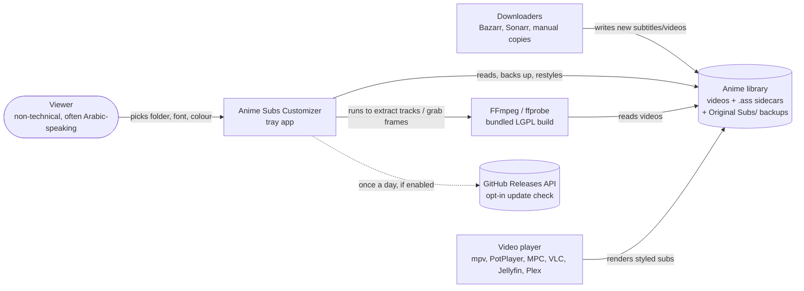

# Architecture

Anime Subs Customizer is a single-process Windows desktop app. It runs in the system tray, watches one library folder, and restyles the dialogue in `.ass` subtitles. Optionally it extracts embedded subtitle tracks with FFmpeg. There is no server and no telemetry; the only optional network call is the update check (ADR-008).

## Context (C4 level 1)



## Containers (C4 level 2)

```mermaid
flowchart TB
    subgraph exe[AnimeSubsCustomizer.exe - PyInstaller one-folder build]
        gui[GUI - anime_subs_customizer.pyw<br/>customtkinter main window, dialogs,<br/>tray (pystray), --self-test, --quit, --check-styled]
        state[state.py<br/>AppState + ConfigManager]
        mon[monitor.py<br/>FolderMonitor thread + watchdog]
        ass[ass_editor.py<br/>decode, typesetting detection,<br/>compute/apply, backup/restore, extraction]
        fonts[fonts.py<br/>font list, coverage, size ratios<br/>HarfBuzz + FreeType]
        db[db.py<br/>SQLite WAL file index]
        media[media.py<br/>FFmpeg locator]
        inst[instance.py<br/>named mutex + quit event]
        rt[runtime.py<br/>paths, config, logging, atomic IO, issues]
        i18n[i18n.py<br/>English + Arabic strings]
    end
    data[(Data folder<br/>%LOCALAPPDATA%\Anime Subs Customizer)]
    lib[(Library)]
    ff[bin\ffmpeg.exe, ffprobe.exe]

    gui --> state & mon & ass & fonts & inst & i18n
    mon --> ass & db & media
    ass --> db & fonts & rt
    state --> db & rt
    fonts --> rt
    media --> rt
    db --> data
    rt --> data
    ass --> lib
    media --> ff
```

The module dependency direction is **runtime ← (db, fonts, media, i18n, instance) ← ass_editor ← state ← monitor ← GUI**. `anime_subs_core.py` is a re-export façade kept for the GUI's `from anime_subs_core import *` and for the tests. Every package module declares `__all__`, so a missing import fails when the module loads, not at run time.

## Threads

| Thread | Owns | Talks to Tk via |
|---|---|---|
| Main (Tk mainloop) | all widgets, dialogs, config saves (debounced 500 ms), the preview renderer | — |
| `FolderMonitor.run` | the reconcile loop: list → decide → backup → write → record | `AppState.note_event` → listener → `root.after` |
| watchdog observer | only sets `AppState.wake_event`; never decides anything | — |
| extraction pool (2 workers) | ffprobe/ffmpeg subprocesses, one video per job | `note_event`, `IssueTracker` listeners |
| pystray | tray icon + menu | every callback marshals with `root.after(0, …)` |
| quit listener (`instance.py`) | waits on the named quit event | `root.after(0, …)`, plus a 10 s hard-exit backstop |
| background helpers | font list load, font-path map warm-up, FFmpeg locate, preview frame grab | `root.after` |

The monitor is **watchdog-woken but state-reconciled**. Filesystem events only wake the loop. What to do with each file comes from its recorded mtime, content hash and status, so duplicate events and the app's own writes can't cause a loop (see ADR-007 for other writers).

## Data flow: one subtitle

1. **List.** `list_ass_files(folder)` returns every `.ass` file except those under `Original Subs/` and atomic-write temps.
2. **Decide.** Skip the file if its mtime and status are unchanged, or if its hash matches what we last wrote, or if it's restored/foreign (ADR-006/007), or if `is_already_styled` says so.
3. **Compute.** `compute_changes` decodes strictly (BOM → UTF-8 → chardet → legacy code pages), finds the typesetting styles to leave alone, and rewrites only dialogue Style rows and the leading colour block of their Dialogue lines. Everything else stays byte-for-byte: encoding, line endings, `[Fonts]`, extradata, comments.
4. **Coverage.** If the chosen font can't render the file's dominant script, the file is skipped and left untouched.
5. **Backup.** The ADR-006 table decides whether `Original Subs/<name>` is created, refreshed (the old copy goes to `.older/`) or left as is.
6. **Write.** `atomic_write` writes a temp file in the same folder, fsyncs it, then `os.replace`s it over the original, retrying while the target is locked.
7. **Record.** The DB gets the new mtime, content hash and status, and the footer shows "Styled <name>".

## Where data lives

| What | Where | Notes |
|---|---|---|
| Settings `config.json`, file index `files_monitor.db` (+ `-wal`/`-shm`), `monitor.log` (6 × 1 MB), caches, `crash-*.txt` | `%LOCALAPPDATA%\Anime Subs Customizer` | Portable ZIP and source runs: beside the app. Test token: `%TEMP%\asc-instance-<token>` (ADR-003). |
| The app | `%LOCALAPPDATA%\Programs\Anime Subs Customizer` | replaced on upgrade; no user data |
| Originals | `<series folder>\Original Subs\<name>` (older copies in `Original Subs\.older\`) | never touched by the installer or the uninstaller |
| Autostart | `%APPDATA%\Microsoft\Windows\Start Menu\Programs\Startup\Anime Subs Customizer.lnk` | respects the Windows Startup-apps switch (`StartupApproved`) |
| Installer language seed | `HKCU\Software\Anime Subs Customizer\InstallerLanguage` | read only on first run |

## Trust boundaries

1. **Subtitle and video files are untrusted input.** Size cap 64 MB; strict decoding with skip-on-failure; paths resolved and contained within the library (`SecurityUtils.validate_path`); filenames built from ffprobe metadata are sanitised; SSA v4 files are skipped rather than rewritten.
2. **External programs.** FFmpeg/ffprobe are resolved to absolute paths: bundled `bin\` first, then PATH, rejecting a hit in the current directory. They run with argument lists (no shell) and timeouts, and their output is decoded as UTF-8 explicitly.
3. **The network** (opt-in only): one HTTPS GET to `api.github.com`. Nothing is downloaded or run (ADR-008).
4. **Other local processes.** The named mutex and quit event are per session. A `--quit` request can only ask the app to exit cleanly.
5. **Logs contain library paths and the Windows username.** They stay local; the "Report a problem" flow warns before a user attaches them.

## Packaging

- PyInstaller one-folder build (ADR-001) inside a per-user Inno Setup installer (ADR-002), plus a portable ZIP.
- FFmpeg: a minimal LGPL build made from source by `packaging/ffmpeg/build-ffmpeg.sh` (ADR-004).
- Trust: checksums, attestation, SBOM and an immutable release, unsigned for now (ADR-005).
- Release process: [releasing.md](releasing.md).
