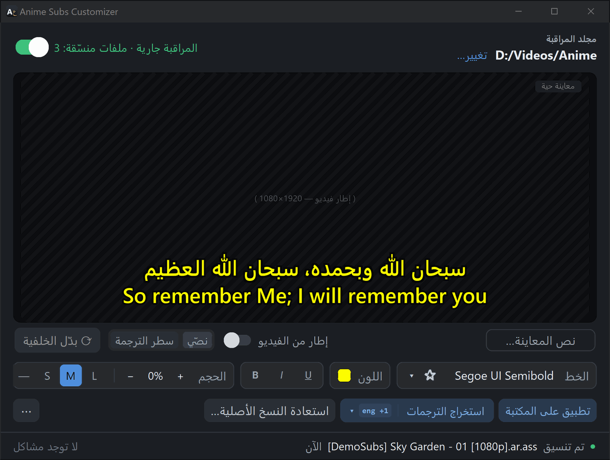

العربية · [**English**](guide.md)

# دليل الاستخدام

## النافذة الرئيسية

- **مجلد المراقبة** (في الأعلى): مجلد الأنمي لديك، ويختار زر **تغيير…** مجلدًا آخر. اختر المجلد الذي يضم مسلسلاتك، مثل ‎`D:\Videos\Anime`‎، وليس قرصًا كاملًا.
- مفتاح **المراقبة** (أعلى النافذة): ما دام مفعّلًا يُبقي التطبيق كل ترجمات ‎`.ass`‎ في المجلد منسّقة، ومنها الترجمات الجديدة بعد ثوانٍ من وصولها. وعند تشغيله أول مرة لمجلدٍ ما، يعرض التطبيق عدد ملفات الترجمة التي سيعيد تنسيقها ويطلب تأكيدك.
- **المعاينة الحية**: نص المعاينة بخطك ولونك مع الحد الأسود الذي يضيفه التطبيق. فعّل **إطار من الفيديو** لعرض لقطة من أحد فيديوهاتك خلفه، واضغط **بدّل الخلفية** لاختيار لقطة أخرى. ويعرض **سطر الترجمة** سطرًا حقيقيًا من ترجماتك على اللقطة التي يظهر فيها. ويغيّر زر **نص المعاينة…** النص.
- **الخط**: اكتب اسم الخط، أو استخدم عجلة الفأرة أو مفاتيح الأسهم للتنقل بين الخطوط، أو اضغط **▾** لفتح منتقي الخطوط. وتميّز النجمة الخطوط المفضّلة.
- **اللون**: لون نص الحوار.
- **B / I / U**: عريض، مائل، تسطير.
- **الحجم**: يُبقي **—** حجم كل ملف كما هو، وتضبط **S / M / L** حجمًا يبدو متماثلًا في كل الإصدارات وكل الخطوط، ويضبط **− / +** الحجم بدقة للخط الحالي.
- **تطبيق على المكتبة**: يعيد تنسيق الملفات الموجودة في مكتبتك، مثلًا بعد تغيير الخط، ويتخطى الملفات المنسّقة مسبقًا بالإعدادات الحالية.
- **استخراج الترجمات**: يحفظ ترجمات الفيديوهات الجديدة في ملفات مستقلة بجانبها. اختر اللغات من **▾**.
- **استعادة النسخ الأصلية…**: يعيد النسخ الأصلية المحفوظة.
- **⋯**: خيارات إضافية (انظر أدناه).
- **سطر الحالة** (في الأسفل): آخر ما فعله التطبيق، و«المشاكل» إن حدث خطأ.

## الخطوط

يعرض منتقي الخطوط كل خط بشكله الحقيقي مع عيّنة بالعربية والإنجليزية. ويعرض فلتر **يدعم العربية** الخطوط التي تعرض العربية فقط، ويعرض **★ المفضّلة** الخطوط التي ميّزتها بنجمة.

يجب أيضًا أن يكون الخط مثبّتًا حيث تشاهد: على حاسوب آخر أو تلفاز أو هاتف، ثبّت الخط نفسه هناك أو اختر خطًّا مثبّتًا عليه.

إذا كان الخط المختار لا يعرض لغة ملفٍّ ما (مثل ترجمة إنجليزية مع خط عربي فقط)، يترك التطبيق ذلك الملف كما هو بدل أن يملأه بمربعات فارغة.

## نسخك الأصلية

- قبل أول تنسيق لأي ملف ترجمة، تُنسخ النسخة الأصلية إلى مجلد **Original Subs** بجانبه. لا تحذف هذه المجلدات إن كنت قد تريد استعادة النسخ الأصلية.
- إذا استبدل برنامج تنزيل ملف ترجمة بإصدار أحدث، يصبح الإصدار الأحدث هو النسخة الأصلية المحفوظة، وتُحفظ النسخة الأقدم في ‎`Original Subs\.older`‎.
- يعيد **استعادة النسخ الأصلية…** (والمراقبة متوقفة) النسخ الأصلية للمسلسلات التي تختارها. وتبقى الملفات المستعادة على حالها الأصلية: لا تغيّرها المراقبة حتى تصل نسخة جديدة منها، ويعيد **تطبيق على المكتبة** تنسيقها إن غيّرت رأيك.

## استخراج الترجمات

كثير من الفيديوهات تحمل ترجماتها داخل ملف الفيديو. عند تفعيل **استخراج الترجمات** يحفظ التطبيق ترجمات كل فيديو **جديد** في ملفات ‎`.ass`‎ أو ‎`.srt`‎ بجانبه، باللغات التي اخترتها من **▾** (وكل اللغات إن لم تختر شيئًا). ويعمل **⋯ ← استخراج كل الترجمات** على كل الفيديوهات في المجلد. لا يمكن استخراج الترجمات المصوّرة من أقراص DVD.

## قائمة ⋯

- **استخراج كل الترجمات**: الاستخراج من كل الفيديوهات في المجلد.
- **فتح السجل**: سجل نشاط التطبيق، ويفيد عند الإبلاغ عن مشكلة.
- **إعادة تعيين…**: مسح الإعدادات أو قائمة الملفات المنسّقة الخاصة بالتطبيق. لا تُحذف ترجماتك ولا نسخها الاحتياطية أبدًا.
- **التشغيل تلقائيًا عند تسجيل الدخول** و**البدء مُصغَّرًا**: تشغيل التطبيق مع ويندوز في منطقة الإعلام.
- **اللغة**: English أو العربية (يعيد التطبيق تشغيل نفسه).
- **التحقق من التحديثات مرة يوميًا**: معطّل افتراضيًا، وعند تفعيله يخبرك التطبيق بتوفر إصدار جديد.
- **دليل الاستخدام**، **الإبلاغ عن مشكلة…**، **حول التطبيق**.

## منطقة الإعلام

عند إغلاق النافذة يسألك التطبيق: هل يواصل العمل في منطقة الإعلام (بجانب الساعة) أم يُنهي العمل؟ وما دام هناك فهو يواصل مراقبة مجلدك. انقر أيقونته لفتح النافذة. قد يخفي ويندوز الأيقونات الجديدة تحت السهم **^**، ويمكنك سحبها خارجه لتبقى ظاهرة.

## عند حدوث مشكلة

تعرض لوحة «المشاكل» أسفل النافذة الملفات التي لم يستطع التطبيق تغييرها مع السبب بكلمات واضحة. من الأسباب الشائعة:

- **منع Windows هذا التغيير**: الملف للقراءة فقط، أو «الحماية من برامج الفدية» (الوصول المتحكَّم فيه إلى المجلدات) مفعّلة. راجع [دليل التثبيت](install-help.ar.md).
- **يستخدم برنامج آخر هذا الملف**: غالبًا مشغّل الفيديو، وسيحاول التطبيق مجددًا لاحقًا.
- **تعذّر الوصول إلى المجلد**: قرص مفصول أو مشاركة شبكة غير متصلة.
- **غيّر برنامج آخر هذا الملف بعد تنسيقه**: نسخة أخرى من التطبيق أو محرر ترجمات. يتركه التطبيق كما هو، ويعيد **تطبيق على المكتبة** تنسيقه.

إذا واجه التطبيق نفسه خطأً، يعرض نافذة فيها **نسخ التفاصيل** و**فتح مجلد السجل**. أرفق هذه التفاصيل عند [الإبلاغ عن مشكلة](https://github.com/roko-tech/Anime-Subs-Customizer/issues/new/choose)، وراجع السجلات أولًا لأنها تحتوي أسماء مجلداتك وملفاتك.

## أين توجد الأشياء

| ماذا | أين |
|---|---|
| التطبيق | ‎`%LOCALAPPDATA%\Programs\Anime Subs Customizer`‎ |
| الإعدادات وقائمة الملفات المنسّقة والسجلات | ‎`%LOCALAPPDATA%\Anime Subs Customizer`‎ |
| النسخ الأصلية | مجلد «Original Subs» بجانب كل ملف ترجمة |

أما النسخة المحمولة فتحفظ إعداداتها في مجلدها.

