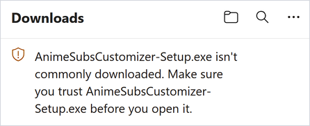
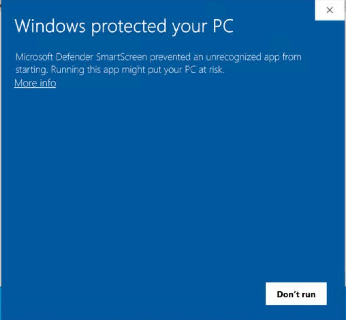
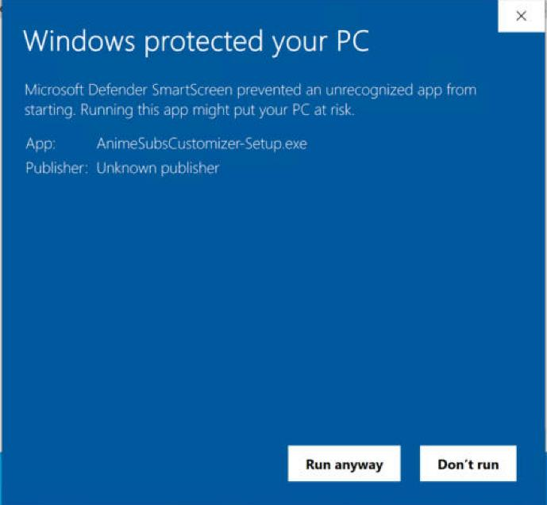

[**العربية**](install-help.ar.md) · English

# Installing: Windows warnings explained

Anime Subs Customizer is new and not code-signed yet. A code-signing certificate costs money every year, and free signing for open-source projects is only available once a project has published releases. Until the app is signed, Windows doesn't recognise it and shows a warning **once, when you install it**. After installation the app starts without any warning.

Below is what you'll see and what to do. Before you click past a warning, you can [check that your download is genuine](#check-your-download).

## 1. Edge: "…isn't commonly downloaded"

Edge may hold the download back with a message such as *"AnimeSubsCustomizer-Setup.exe isn't commonly downloaded. Make sure you trust it before you open it."*

1. Point at the download and click **⋯** (More actions).
2. Choose **Keep**.
3. Click **Show more**, then **Keep anyway**.



Chrome and Firefox usually download it without asking.

## 2. "Windows protected your PC"

When you open the installer, Microsoft Defender SmartScreen may show a blue window: *"Microsoft Defender SmartScreen prevented an unrecognized app from starting."*

1. Click **More info**.
2. Check that it says **App: AnimeSubsCustomizer-Setup.exe**. *Publisher: Unknown publisher* is expected for an unsigned app.
3. Click **Run anyway**.

 

The installer doesn't ask for administrator rights: it installs only for you, in `%LOCALAPPDATA%\Programs\Anime Subs Customizer`.

## 3. Smart App Control (Windows 11)

Some Windows 11 PCs have **Smart App Control** turned on. It blocks apps that aren't known and aren't signed, and it has **no "Run anyway" button**. It also doesn't let you make an exception for one app. If it blocks the installer, you'll see *"Smart App Control blocked an app that may be unsafe."*

You have two options:

- **Wait for a signed release.** We're applying for free code signing for open-source projects. Signed versions will install without this block. This is the safest choice.
- **Turn Smart App Control off.** Open **Windows Security → App & browser control → Smart App Control settings → Off**. This removes a protection for every app, not just this one, so only do it if you're comfortable with that. Smart App Control also checks apps each time they start, so it has to stay off while you use this unsigned version. **Check first whether you can turn it back on later:** Windows 11 24H2 and 25H2 with the April 2026 cumulative update (KB5083769) or newer let you switch it back **On**, for example after you uninstall the app. On older versions, turning it off can only be undone by resetting Windows.

## 4. Antivirus warnings

The app is built with PyInstaller, a common tool for packaging Python apps. Some antivirus programs flag apps built this way even when they're harmless. The app also rewrites many subtitle files, which behaviour-based protections watch closely.

- Every release is scanned on VirusTotal before it's published, and the results are linked from the release page.
- If your antivirus quarantines the app, [check your download](#check-your-download). Then restore it from quarantine, or allow it in your antivirus. You can also report it to your antivirus vendor as a false positive.
- **Windows Security → Ransomware protection (Controlled folder access)** can stop the app from changing subtitles in protected folders such as Documents or Videos. The app then shows *"Windows blocked the change…"* under **Issues**. Click **Allow an app through Controlled folder access**, add `AnimeSubsCustomizer.exe` from `%LOCALAPPDATA%\Programs\Anime Subs Customizer`, or keep your anime library in a folder that isn't protected.

## Check your download

Every release comes with a list of SHA-256 checksums and a GitHub build attestation, so you can confirm that a file is exactly what GitHub built from this project's source code.

**The quick way (no extra tools):**

1. Open PowerShell in your Downloads folder (Shift + right-click in the folder → **Open PowerShell window here**).
2. Run:

   ```powershell
   Get-FileHash .\AnimeSubsCustomizer-Setup.exe -Algorithm SHA256
   ```

3. Compare the long number with the line for `AnimeSubsCustomizer-Setup.exe` in `SHA256SUMS.txt` on the [release page](https://github.com/roko-tech/Anime-Subs-Customizer/releases/latest). They must match exactly.

**The thorough way (GitHub CLI):**

```powershell
gh attestation verify .\AnimeSubsCustomizer-Setup.exe -R roko-tech/Anime-Subs-Customizer
```

This checks that the file was built by this repository's GitHub Actions workflow and hasn't changed since.

Only download the app from [this project's GitHub releases](https://github.com/roko-tech/Anime-Subs-Customizer/releases). Copies from other websites can't be verified.
